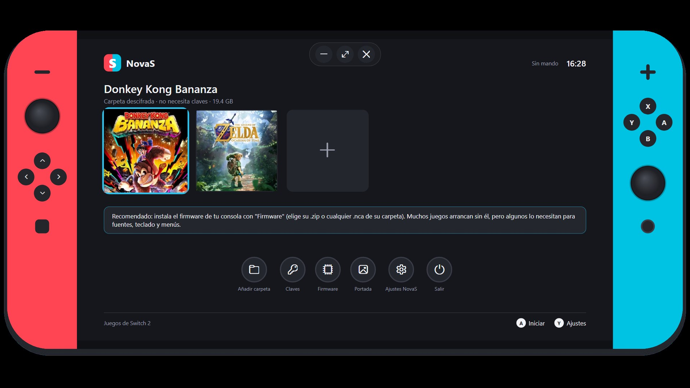
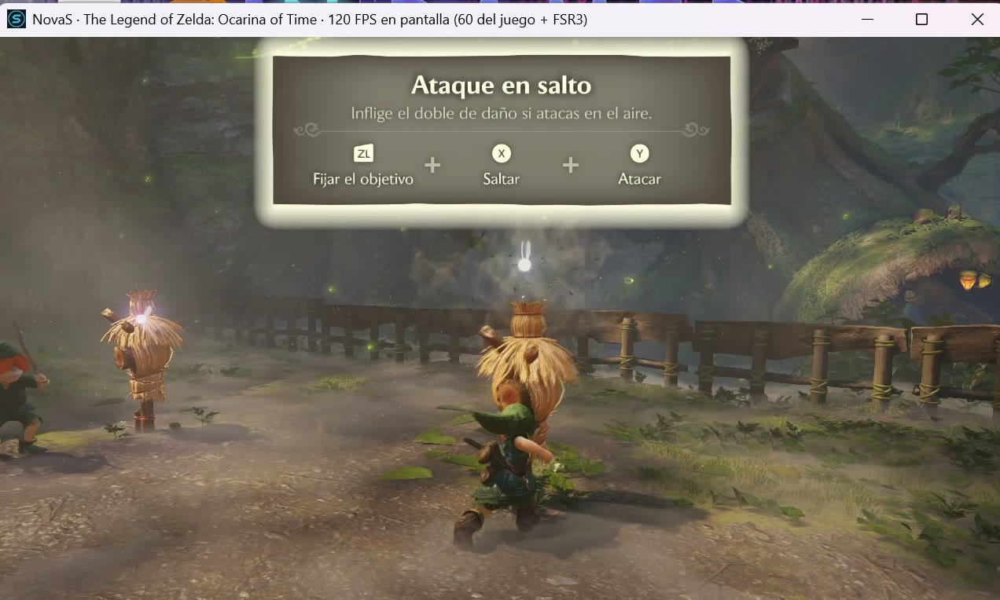
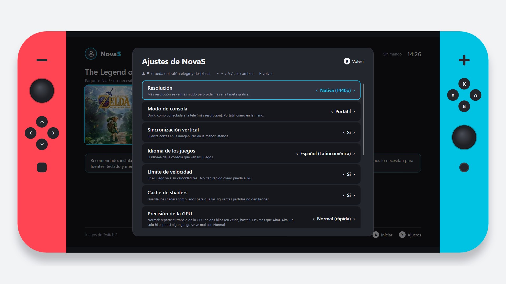
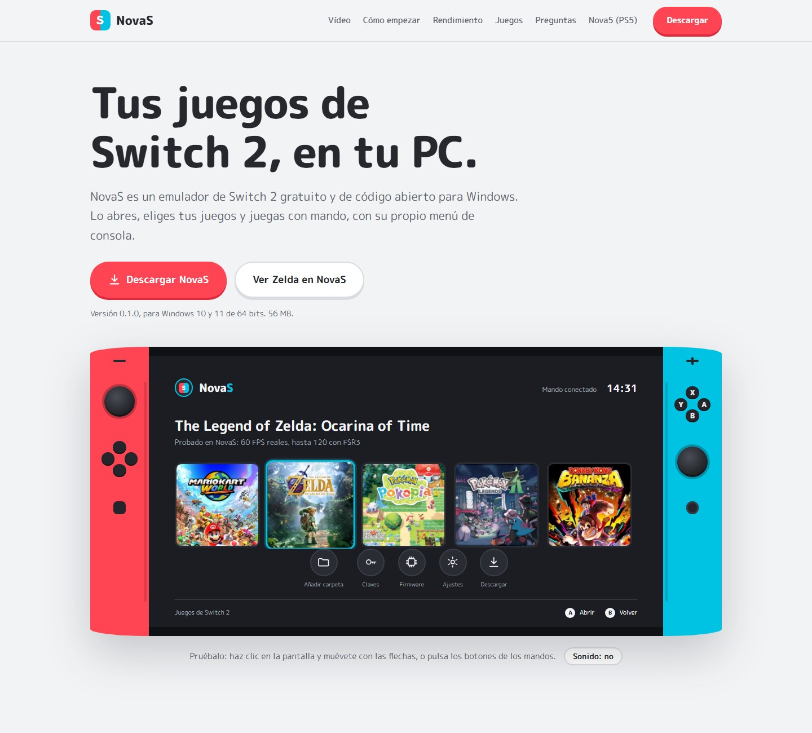

<p align="center">
  
</p>

<h1 align="center">NovaS</h1>

<p align="center"><b>Emulador de Switch 2 gratuito y de código abierto para Windows.</b><br>
Con menú propio de estilo consola, mando, generación de fotogramas FSR3 y resolución hasta 4K.</p>

<p align="center">
  <a href="https://github.com/nova5emu/novas/releases/latest"><b>Descargar NovaS</b></a> ·
  <a href="https://nova5emu.github.io/nova5/novas.html">Web</a> ·
  <a href="https://x.com/nova5emu">X</a> ·
  <a href="https://ko-fi.com/nova5emu">Ko-fi</a>
</p>

> **English:** NovaS is a free, open-source Switch 2 emulator for Windows, with its own console-style menu (in English or Spanish), controller support, FSR3 frame generation and up to 4K. Download it from [Releases](https://github.com/nova5emu/novas/releases/latest). It includes no games, keys or firmware: use your own console's.

## Capturas

<p align="center">
  
</p>
<p align="center">
  
  
</p>
<p align="center">
  
</p>

## Descargar

En [Releases](https://github.com/nova5emu/novas/releases/latest):

- **NovaS-Setup.exe**: instalador. No pide permisos de administrador.
- **NovaS-Portable.zip**: la misma versión sin instalar; descomprime y abre `NovaS.exe`.

NovaS se actualiza solo: al abrirlo te avisa si hay una versión nueva.

## Cómo empezar

1. Abre NovaS.
2. Pulsa **Claves** y elige el `prod.keys` de tu consola (y `title.keys` si lo tienes). Los `.nup` y los juegos descifrados no las necesitan.
3. Pulsa **Firmware** y elige el `.zip` del firmware de tu consola o cualquier `.nca` de su carpeta (recomendado).
4. Pulsa **Añadir carpeta** y elige dónde tienes tus `.nsp`, `.xci` o `.nup`.
5. Elige un juego y pulsa **A**.

NovaS no incluye juegos, claves ni firmware de ninguna consola. Usa los de la tuya.

## Requisitos

- Windows 10 u 11 de 64 bits.
- Tarjeta gráfica con Vulkan 1.3 (recomendadas NVIDIA RTX 3060 o AMD RX 6600 o superiores).
- Procesador moderno de 6 núcleos o más y 16 GB de RAM.

## Rendimiento medido

*The Legend of Zelda: Ocarina of Time* en el Bosque Kokiri (RTX 4070 SUPER, i9-14900KF):

| Ajustes | Tienda | Caminando | Pueblo |
|---|---|---|---|
| Nativa (1440p) | 60 | 52 | 54-57 |
| 4K | 60 | 43 | 49-51 |
| Nativa + FSR3 + "60 dinámico" (imágenes en pantalla) | 120 | 100-120 | 62-115 |

## Compilar

El motor (`NovaSEmulator.exe`, objetivo `yuzu-cmd`) se compila en Windows con Visual Studio 2022 o posterior (C++),
CMake y Ninja:

```
cmake -S . -B _Build/publico -G Ninja -DCMAKE_BUILD_TYPE=Release -DYUZU_TESTS=OFF -DENABLE_UPDATE_CHECKER=OFF ^
      -DENABLE_WEB_SERVICE=OFF -DUSE_DISCORD_PRESENCE=OFF -DENABLE_WERROR=OFF
cmake --build _Build/publico --target yuzu-cmd
```

El menú (`NovaS.exe`) es el lanzador de Nova5 en su modo NovaS; su código está en
[nova5emu/nova5](https://github.com/nova5emu/nova5) (`src/nova5`).

## Licencia y créditos

NovaS se distribuye bajo la licencia GPL-3.0 o posterior (ver `LICENSE.txt` y la carpeta `LICENSES`).
Es una versión modificada de [Eglantine](README-Eglantine.md), que deriva de Eden, yuzu y Sudachi; conserva los avisos
de copyright de sus autores en cada archivo. Los componentes de terceros mantienen sus propias licencias.

NovaS no está afiliado, respaldado ni patrocinado por Nintendo. "Nintendo Switch 2" es una marca de su respectivo dueño.
